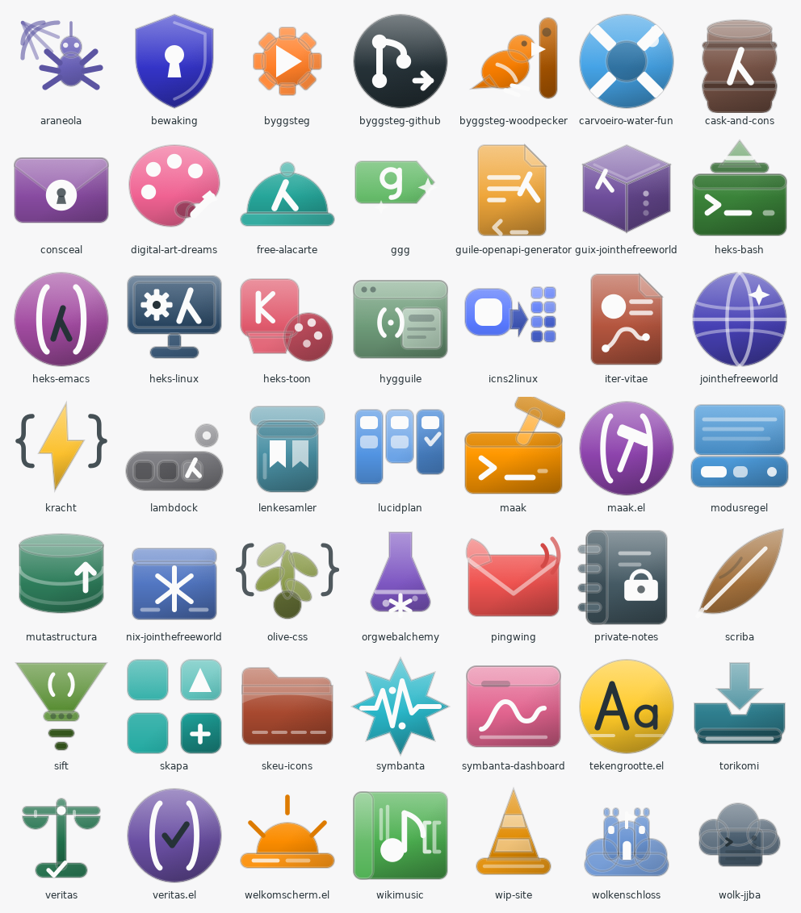
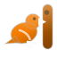

# jointhefreeworld-icons 🌿



One hand-drawn icon for every project in the jointhefreeworld collection:
forty-nine objects, forty-nine colours, not one repeated glyph.

- `svg/<project>.svg` — the 64×64 source, hand-written paths, no bitmaps.
- `png/<project>-{16,32,48,64,128,256,512}.png` — transparent PNG exports.
- `index.html` — the gallery, open it in a browser.
- `preview.png` — a labelled contact sheet of the whole set.
- `icons.json` — name, purpose and accent colour per icon.

## The cloth

*Tela* is Latin for cloth — the warp stretched on the loom before the weaver
begins. The Tela icon theme takes that name seriously. It does not draw
pictures inside rounded squares; it draws *things*. A folder with a tab that
lifts. A terminal with a lip. A disc worn smooth by handling. Nothing is
framed, because nothing needs a frame: the object simply is, and the desktop
arranges itself around it.

These icons are a small act of divination from that cloth. Every project in
the collection was read — its README, its source, the reason it exists — and
then asked what shape it would wear if it had to survive outside the screen.
A crawler became a spider on a half-spun web; a CI bridge became a woodpecker
against a trunk; a secret manager became a sealed envelope; a test framework
became scales that still balance. The answer was cut from the same cloth Tela
weaves: one accent carrying the whole silhouette, a pale face where the light
lands, a shade falling to the lower right, a thin dark line keeping the edge
honest. The colours were not guessed — they were measured from the Tela icons
installed on this machine, so the set can sit beside them without breaking
the circle.

No two drawings are alike, and the build refuses to let them become so: two
projects sharing a silhouette or a glyph is a build error, not a style note.

## The forty-nine

| Icon | Folder | Name | What it is | Accent |
| --- | --- | --- | --- | --- |
|  | `araneola` | Araneola | High-performance web crawler and sitemap generator, pure Guile Scheme | `#6961b8` |
|  | `bewaking` | Bewaking | Encryption, authentication and authorization toolkit for Guile | `#3434c8` |
|  | `byggsteg` | byggsteg | Readable CI/CD orchestrator: pipelines as Lisp, streamed live | `#ff7f28` |
|  | `byggsteg-github` | Byggsteg GitHub | GitHub Actions workflow and action bridging into byggsteg jobs | `#263238` |
|  | `byggsteg-woodpecker` | Byggsteg Woodpecker | Woodpecker CI image that runs byggsteg jobs and reports the outcome | `#f57c00` |
|  | `carvoeiro-water-fun` | Carvoeiro Water Fun | Static site for the water fun park in Carvoeiro, Algarve | `#45a3e6` |
|  | `cask-and-cons` | Cask & Cons | Declarative macOS dotfiles in Scheme, driven by the caco CLI | `#795548` |
|  | `consceal` | Consceal | Declarative secret management and deployment in Guile Scheme | `#884ba1` |
|  | `digital-art-dreams` | Digital Art Dreams | Archive of collected digital artwork, released under CC0 | `#f06292` |
|  | `free-alacarte` | Free à la Carte | Free monads and composable functors for embedded DSLs in Haskell | `#26a69a` |
|  | `ggg` | GGG | Guile Glyph Generator: SVG logos and status badges from Lisp | `#66bb6a` |
|  | `guile-openapi-generator` | Guile OpenAPI Generator | Generates idiomatic Guile server and client code from an OpenAPI 3 spec | `#efa63a` |
|  | `guix-jointhefreeworld` | guix-jointhefreeworld | GNU Guix channel packaging the whole jointhefreeworld collection | `#6f4e9c` |
|  | `heks-bash` | Heks BASH | Declarative Bash configuration and prompt, generated from Scheme | `#3b843a` |
|  | `heks-emacs` | heks-emacs | Modular, reproducible Emacs configuration built with Elpaca | `#a24ba1` |
|  | `heks-linux` | Heks GNU/Linux | Modular, programmable GNU/Linux desktop written as Scheme modules | `#2f4f6f` |
|  | `heks-toon` | heks-toon | GTK4 window showing the desktop's keybindings, wallpapers and palettes | `#e05a6d` |
|  | `hygguile` | Hygguile | Cozy, accessible server-rendered UI framework: SXML in, HTML out | `#6f9c7a` |
|  | `icns2linux` | icns2linux | Turns macOS .icns trees into a reproducible freedesktop icon theme | `#5677fc` |
|  | `iter-vitae` | Iter Vitae | Multi-language CV generator: one Scheme file to HTML and plain text | `#b5563f` |
|  | `jointhefreeworld` | jointhefreeworld | Personal homepage, blog and movement site built from Org with Emacs | `#4741b5` |
|  | `kracht` | kracht | Batteries-included utility library for Guile Scheme programming | `#fbc02d` |
|  | `lambdock` | lambdock | Wayland dock in C and GTK4, with a live Guile Scheme brain | `#85858a` |
|  | `lenkesamler` | Lenkesamler | Bookmark manager and archive that exports HTML, Markdown, Org and XBEL | `#4a90a4` |
|  | `lucidplan` | LucidPlan | Free project management: multi-project workspace with kanban boards | `#5294e2` |
|  | `maak` | maak | Infinitely extensible command runner and project automator in Scheme | `#ff9800` |
|  | `maak.el` | maak.el | Emacs integration for maak: discover, inspect and run tasks from Emacs | `#8e44ad` |
|  | `modusregel` | modusregel | Clean, fast, tree-sitter aware Emacs mode line | `#4f9fe0` |
|  | `mutastructura` | Mutastructura | Checksummed SQL migrations for SQLite, PostgreSQL, CockroachDB and MySQL | `#2e7d5b` |
|  | `nix-jointhefreeworld` | nix-jointhefreeworld | Nix flake carrying the whole jointhefreeworld package collection | `#5277c3` |
|  | `olive-css` | Olive CSS | Utility-first vanilla CSS framework generated with Scheme | `#8a9a4a` |
|  | `orgwebalchemy` | OrgWebAlchemy | Guile library that parses Org-mode with PEG and renders HTML, Markdown or SXML | `#7e57c2` |
|  | `pingwing` | PingWing | Lisp-powered notification nexus: HTTP in, queued and retried SMTP out | `#ef5350` |
|  | `private-notes` | private-notes | Personal knowledge vault: diary, contacts, career and engineering notes | `#455a64` |
|  | `scriba` | Scriba | Structured, levelled, taggable logging for GNU Guile | `#a2703c` |
|  | `sift` | sift | Dialect-aware formatter, linter and language server for Scheme and the Lisps | `#558b2f` |
|  | `skapa` | Skapa | Project scaffolding and templating with S-expression templates | `#1fa8a0` |
|  | `skeu-icons` | Skeu Icons | Skeuomorphic Linux icon theme built from painted objects, in 30 variants | `#a8492f` |
|  | `symbanta` | Symbanta | Privacy-friendly, free analytics core that records events, not people | `#29b6c8` |
|  | `symbanta-dashboard` | Symbanta Dashboard | React dashboard that visualises a symbanta instance without surveillance | `#e2648f` |
|  | `tekengrootte.el` | tekengrootte.el | Proportional, scale-relative Emacs face sizes from nano to colossal | `#ffca28` |
|  | `torikomi` | torikomi | Artemis service that sinks remote URLs into a local media archive | `#2f7f8f` |
|  | `veritas` | Veritas | Guile test framework where a test is a form and the report is a hierarchy | `#1f6f4a` |
|  | `veritas.el` | veritas.el | Emacs integration for the Veritas test framework: run, report, navigate | `#6a4fa3` |
|  | `welkomscherm.el` | welkomscherm.el | Small, calm, theme-respecting welcome screen for Emacs | `#fb8c00` |
|  | `wikimusic` | WikiMusic | Collaborative music wiki built with GNU Artanis and Guile | `#4caf50` |
|  | `wip-site` | wip-site | Dependency-free maintenance and coming-soon status page | `#e08a00` |
|  | `wolkenschloss` | Wolkenschloss | Hetzner Cloud infrastructure managed from the REST API | `#6b95d3` |
|  | `wolk-jjba` | wolk-jjba | Personal cloud and server fleet provisioned as a Guile program | `#465a6b` |

## The rules of the weave

- **Objects, not tiles.** A folder is a folder, a terminal is a terminal. No
  background plate, no squircle, no badge behind the drawing.
- **One accent per icon.** A silhouette in a single colour, shaded only by
  light: `main` for the body, `light` and `pale` for the top face, `dark` and
  `deep` for the sides and the recesses.
- **White carries the meaning.** Lettering, arrows, seams, holes and highlights
  are cut in paper-white, the way Tela marks its folders and drives.
- **Light from above, shade to the lower right.** A clipped gloss across the
  top, a soft diagonal shadow in the corner, and a hairline outline so the
  object keeps its edge on a pale wallpaper.
- **One family per idea.** Related projects share a form on purpose — the four
  Emacs extensions are all discs, distinguished by what they hold — while
  everything else earns its own silhouette.

## Rebuilding

```sh
python3 tools/build.py
```

Requires Python 3, Inkscape (for the PNG exports) and Pillow (for
`preview.png`). The build validates the set first, then writes `svg/`,
`png/`, `icons.json`, `index.html`, `preview.png` and this file.

## Lineage and licence

This set is original work, released under the MIT licence (see `LICENSE`).
Its inspiration is the [Tela icon theme](https://github.com/vinceliuice/Tela-icon-theme)
by Vinceliuice, which is GPL-3.0: no Tela file is copied or modified here.
What travels between the two sets is colour and discipline — the palette was
sampled from Tela's own icons, and the drawing rules follow its example.
